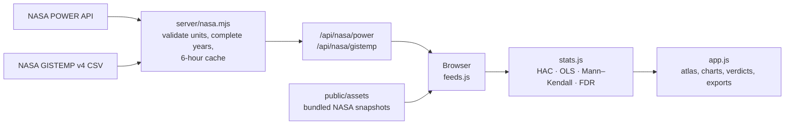

<div align="center">


# EarthLens

### Real data. Meaningful change.

**An Earth-system trend detective built on NASA open data.**
Pick a variable, pick a place, and find out what is changing, where, by how much, and whether the change is statistically significant.

[](https://www.spaceappschallenge.org/2026/challenges/earth-system-trend-detective/)
[](https://power.larc.nasa.gov/)
[](https://data.giss.nasa.gov/gistemp/)
[](https://nodejs.org)


</div>

## Live Link: https://earthlens-observatory.ababil-cox-8536.chatgpt.site/#explore

---

## The challenge

> *"Your challenge is to create a tool that can select variables measured by Earth science missions or produced by Earth science models, visualize how they change over time, and determine what is changing, where it is changing, how much it is changing, and if these changes are what scientists call 'significant'."*
> — NASA Space Apps Challenge 2026, **Be an Earth System Trend Detective!**

EarthLens answers all four questions in one screen.

| The challenge asks | EarthLens answers with |
| --- | --- |
| **What** is changing? | Five variables: air temperature, precipitation, humidity, wind speed and the GISTEMP surface-temperature anomaly |
| **Where** is it changing? | A world atlas of 16 sampled coordinates and 8 latitude bands, plus any coordinate you add |
| **How much**? | Rate per decade and fitted change over the period you choose |
| Is it **significant**? | Three trend tests, confidence intervals, and false-discovery-rate correction |

## What it found

Air temperature at 2 m, 1981 to 2025, at the 16 bundled NASA POWER grid points:

| | |
| --- | --- |
| Locations trending warmer | **15 of 16** |
| Locations with a significant trend after FDR correction | **13 of 16** |
| Fastest warming | Central Europe and Central Greenland, **+0.52 °C per decade** |
| The exception | Dhaka, **−0.23 °C per decade** (95% interval −0.35 to −0.12) |

One variable, one planet, opposite directions. That is exactly the puzzle the challenge describes.

> These are single model grid cells, not regional averages. "Dhaka" means the MERRA-2 cell at 23.8° N, 90.4° E.

## Demo video

https://github.com/user-attachments/assets/REPLACE-AFTER-UPLOAD

<sub>To show the video here, open this README in GitHub's editor, drag `EarthLens-showcase.mp4` into it, and replace the line above with the link GitHub generates.</sub>

## Features

<table>
<tr>
<td width="50%" valign="top">

### Planetary change atlas
Every location is a marker. Colour shows direction, size shows magnitude, and a filled marker means the trend is significant.


</td>
<td width="50%" valign="top">

### Time series with uncertainty
Annual values, the fitted trend, and a 95% confidence band for the mean trend.


</td>
</tr>
<tr>
<td width="50%" valign="top">

### A verdict in plain language
Direction, rate, interval, p-value and residual autocorrelation, written so a student can read it.


</td>
<td width="50%" valign="top">

### And more
- **Compare** up to four locations on a common baseline
- **Add any coordinate** and fetch its NASA record live (up to 40 study points)
- **Import your own annual CSV**, clearly labelled as user supplied
- **Export** results, observations, vector charts and a standalone HTML report
- **Save a workspace** on your device or as a portable project file
- **Methodology page** that explains every test and its limits

</td>
</tr>
</table>

## The data is real

Every built-in value is an actual NASA download. Nothing is simulated.

| Source | What it provides | Coverage | Endpoint |
| --- | --- | --- | --- |
| **NASA POWER** (MERRA-2 reanalysis) | Air temperature at 2 m, corrected precipitation, relative humidity at 2 m, wind speed at 10 m | 1981–2025, 16 coordinates | `power.larc.nasa.gov/api/temporal/monthly/point` |
| **NASA GISTEMP v4** | Land–ocean temperature anomalies relative to 1951–1980 | 1880–2025, 8 latitude bands | `data.giss.nasa.gov/gistemp/tabledata_v4/ZonAnn.Ts+dSST.csv` |
| Natural Earth | Country outlines for the map only | — | Public domain |

- **No API key** is needed.
- **Complete years only.** A year counts only if all twelve months are present.
- **Live refresh.** The app re-checks NASA when a study opens and every 30 minutes while the tab is visible. A manual refresh bypasses the cache.
- **Honest failure.** If NASA is unreachable, the app keeps the last validated records and says so.
- **Reproducible snapshots.** `python fetch_data.py` re-downloads both bundled datasets.

The raw NASA responses are kept in [`public/assets`](public/assets) so anyone can audit them.

## The statistics

| Method | What it does |
| --- | --- |
| **Linear trend, HAC robust** (default) | OLS slope with Newey–West standard errors, so year-to-year autocorrelation does not inflate confidence |
| **Linear trend, ordinary OLS** | Classic Student's t-test with n − 2 degrees of freedom |
| **Mann–Kendall + Sen's slope** | Rank-based test for monotonic change, with tie correction |
| **Benjamini–Hochberg FDR** | Adjusts for testing many locations at once. "Significant" means q ≤ α, not just p ≤ α |

Guard rails: at least eight annual values are required, missing years are never interpolated, and significance is never presented as proof of cause.

## How it works



Trends are computed in your browser. The server only fetches, validates and caches NASA responses, and it accepts no arbitrary URL.

## Quick start

Requirements: **Node.js 22.13+** and **pnpm**. An internet connection is needed for live NASA refresh.

```sh
git clone <your-repo-url>
cd Nasa-Space-App-Challenge-Preli
pnpm install --frozen-lockfile
pnpm dev
```

Open `http://localhost:5173`.

To build and run the compiled app:

```sh
pnpm build
pnpm start
```

> This is a Vinext / Cloudflare Worker application. Opening `index.html` directly will not provide the NASA API routes.

## Tests

```sh
node tests/test-stats.cjs
node tests/test-import.cjs
node tests/test-nasa.mjs
node tests/test-ui.cjs
node tests/test-workspace.cjs
node tests/test-feeds.cjs
python tests/reference-check.py
```

The suite covers real NASA fixtures, incomplete years, unit changes, cache dates, source outages, persistence, import and export, and checks the statistics against SciPy and statsmodels. DOM tests need `jsdom`; the Python reference check needs SciPy and statsmodels.

## Project structure

```text
app/api/nasa/        Server routes for POWER and GISTEMP
server/nasa.mjs      Fixed NASA upstreams, validation, timeouts, caching
public/app.js        Analysis controls, atlas, charts, verdicts
public/stats.js      Trend estimators, uncertainty, significance, FDR
public/feeds.js      NASA refresh workflow
public/workspace.js  Saved projects, imports, exports
public/assets/       Bundled NASA responses and provenance
fetch_data.py        Reproducible snapshot refresh
tests/               Statistical, data, UI and workspace checks
```

## Limits worth knowing

- POWER values are **model grid-cell samples**, not station measurements or regional averages.
- GISTEMP values are **broad zonal averages**, not local readings.
- The app shows annual trends. It does **not** claim real-time conditions.
- Statistical significance does not establish cause, practical importance or future change.

## Acknowledgements

- [NASA POWER](https://power.larc.nasa.gov/) and the MERRA-2 reanalysis, NASA Langley Research Center
- [NASA GISS Surface Temperature Analysis (GISTEMP v4)](https://data.giss.nasa.gov/gistemp/)
- [Natural Earth](https://www.naturalearthdata.com/) for map geometry
- Newey & West (1987), Sen (1968), Benjamini & Hochberg (1995)

EarthLens is an independent research tool. It is not affiliated with or endorsed by NASA.

## Team

<!-- Add your team name and members here -->

Built for the **NASA Space Apps Challenge 2026**.
